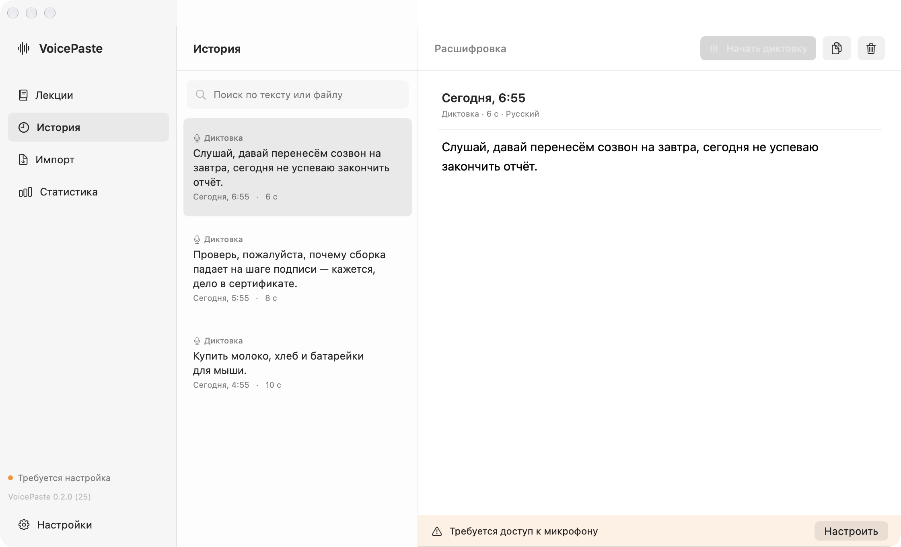
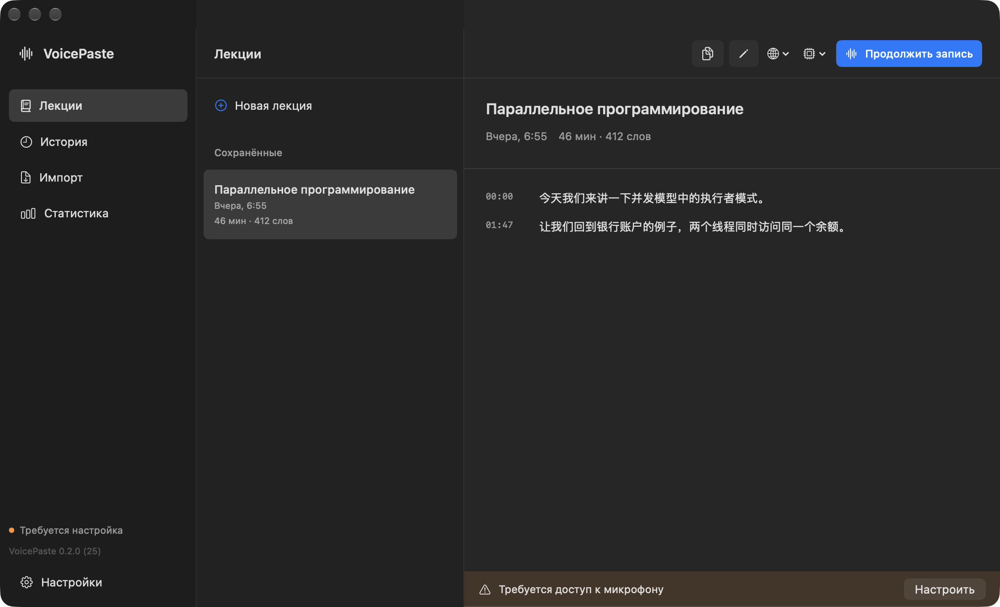
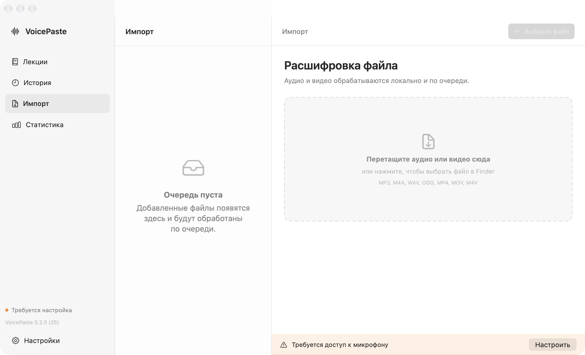
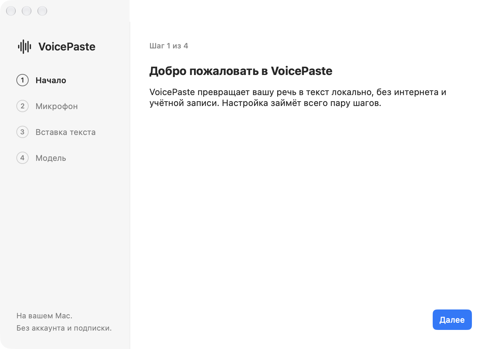

# VoicePaste

**Речь в текст на вашем Mac.** Диктовка с автоматической вставкой, расшифровка файлов и запись лекций — локально, без аккаунта и подписки.

[](https://github.com/ilyaVasiliev1/voice-paste/actions/workflows/ci.yml)

[Скачать для Mac](https://github.com/ilyaVasiliev1/voice-paste/releases/latest) · [Что нового](CHANGELOG.md) · [Сообщить об ошибке](https://github.com/ilyaVasiliev1/voice-paste/issues)



## Три основных сценария

**Наговорить и вставить.** Поставьте курсор в нужное поле и нажмите `⌥Space`. Наговорите текст, нажмите сочетание ещё раз — VoicePaste распознает речь и вставит результат. Сочетание и режим записи меняются в настройках. История сохраняется на устройстве; в ней есть поиск и редактирование.

**Расшифровать файл.** Перетащите аудио или видео в раздел «Импорт» либо выберите файл через Finder. Очередь обрабатывается локально, результат появляется в истории. Поддерживаются MP3, M4A, WAV, OGG/Opus, MP4, MOV и M4V; из видео используется звуковая дорожка.

**Записать лекцию.** Выберите язык и начните запись. Текст появляется абзацами с отметками времени. Запись можно сохранить, переименовать, скопировать и продолжить позднее. Уже распознанные абзацы сохраняются промежуточно; если запись оборвалась, приложение отмечает её как неполную.

Русский, английский и китайский; автоматическое определение языка; пунктуация средствами модели. Статистика показывает объём и время речи.

## Как выглядит

### Лекции с отметками времени



### Импорт аудио и видео



### Первый запуск



На скриншотах демонстрационные записи. Личные разговоры и история пользователя для них не используются. Интерфейс написан на SwiftUI и AppKit, с собственными компонентами и поддержкой светлой и тёмной тем.

## Установка

Нужны **macOS 15+** и **Apple Silicon: M1 или новее**. Intel Mac не поддерживается.

1. Скачайте `VoicePaste.dmg` со страницы [Releases](https://github.com/ilyaVasiliev1/voice-paste/releases/latest).
2. Закройте прежний VoicePaste, если он запущен. Откройте образ и перетащите приложение в **Программы**, подтвердив замену. Запускайте именно эту копию.
3. При первом запуске пройдите настройку: микрофон, разрешение для автоматической вставки, локальная модель.
4. Модель занимает около **626 МБ** и загружается отдельно. Можно выбрать GitHub, Hugging Face или зеркало. После установки распознавание работает без сети.

Публичная сборка пока **не нотарифицирована Apple**. Если macOS блокирует запуск, откройте **Системные настройки → Конфиденциальность и безопасность → Всё равно открыть** для VoicePaste. При обновлении такой сборки macOS может запросить разрешения повторно. Поддержка подписи Developer ID предусмотрена в скрипте выпуска.

Микрофон используется для диктовки и лекций. Универсальный доступ нужен для вставки текста в другие приложения; в новых версиях macOS этот раздел может называться «Управление устройством и доступ к данным».

## Качество и ограничения

Для лекции лучше явно выбрать язык. На macOS 26+ потоковый системный движок используется, когда нужный язык и ресурсы уже доступны на устройстве; иначе применяется Whisper. Дополнительные языковые ресурсы во время записи не скачиваются.

Расстояние до говорящего, микрофон, шум и смешение языков влияют на результат. Приложение не гарантирует точную расшифровку преподавателя из дальнего конца аудитории. На тишине распознаватели могут придумывать фразы; VoicePaste отсекает цифровую тишину и обрабатывает тихие окончания, но полностью исключить ошибки модели нельзя.

Режим лекций создаёт **расшифровку с таймкодами**, а не автоматическое краткое содержание. Для окончательной расшифровки нажмите «Стоп» перед выходом из приложения.

## Приватность и хранение

Аудио, расшифровки, история и словарь обрабатываются локально и не отправляются на сервер. Сеть используется для явно запущенной загрузки модели. Модель и данные сохраняются при замене приложения.

Звук лекции временно пишется в локальный файл с правами только для владельца: длительная запись не накапливается целиком в оперативной памяти. После обычного завершения временный файл удаляется. После аварии он может остаться до очистки системой; восстановление исходного аудио пока не поддерживается. Восстанавливается последний сохранённый текст.

Для удаления приложения вместе с моделью и данными есть `scripts/uninstall.sh`: он показывает, что будет удалено, и запрашивает подтверждение.

## Разработка и сборка

Нужны **Xcode 26+**, Swift 6 и Apple Silicon. Версии зависимостей закреплены в `Package.resolved`.

```bash
git clone https://github.com/ilyaVasiliev1/voice-paste.git
cd voice-paste
open VoicePaste.xcodeproj
```

Выберите схему **VoicePaste** и запустите приложение. Первая сборка скачивает зависимости. [Проверки, выпуск и локальное обновление без смены подписи](docs/DEVELOPMENT.md).

Исследования движков и воспроизводимые замеры находятся в [research](research/2026-11-01-model-benchmark.md). Qwen исследован отдельно и не встроен в выпускаемое приложение.

## Лицензия и благодарности

[MIT](LICENSE). Распознавание — [WhisperKit](https://github.com/argmaxinc/WhisperKit) и [Whisper](https://github.com/openai/whisper), локальная база — [GRDB](https://github.com/groue/GRDB.swift).
